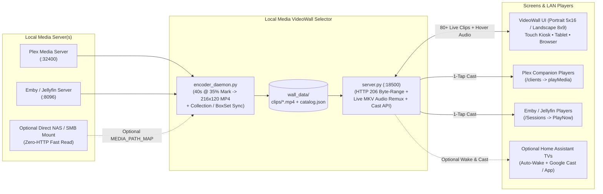

# 🎬 Local Media VideoWall Selector — Plex, Emby & Jellyfin

[](LICENSE)
[-3776AB.svg?logo=python&logoColor=white)](#quick-start)
[](#supported-media-servers--cast-targets)
[](#option-a-docker-compose-recommended)

> **Stop spending 45 minutes scrolling static posters trying to pick a movie.**
> Turn any Portrait (`1080×1920`) or Landscape (`1920×1080` / `4K`) screen, tablet, or hallway frame display into a **100% borderless live-playing movie VideoWall** powered by your local **Plex**, **Emby**, or **Jellyfin** library — hover or tap any clip to hear its scene audio, and **double-tap to send the full movie straight to any TV or player on your local network** (or watch right there).

---

## ✨ Why This Exists

When your local media collection grows past a few hundred films, static poster grids cause decision paralysis: you scroll past titles you forgot you owned without remembering the vibe, pacing, or tone of the film.

**Local Media VideoWall Selector** flips movie night from *"searching titles"* into *"catching a scene that grabs you"*:

1. **80+ Simultaneous Live Movie Clips, Zero Idle Server Load**:
   - A background FFmpeg worker (`encoder_daemon.py`) extracts a lightweight **40-second `120p` (`216×120`, ~900 KB) H.264 + normalized stereo AAC scene** from **35% into each movie** (skipping studio logos and opening credits).
   - Once pre-encoded, your Plex / Emby / Jellyfin server sits at **0% CPU/GPU transcode load** 24/7 while the wall streams dozens of simultaneous live scenes locally.
2. **Instant Hover / Touch Scene Audio**:
   - Glide your mouse or tap any playing tile to unmute loudness-normalized (`dynaudnorm`) scene dialogue and soundtrack audio instantly; tap again to mute.
3. **Collections & BoxSets Grouped Together First**:
   - Automatically syncs **Plex Collections** and **Emby / Jellyfin BoxSets**, placing multi-film franchises consecutively side-by-side in viewing/release order right from Row 1, followed by standalone films ordered by sort title + year so sequels stay together.
4. **Double-Tap → Send to Any Player on Your Local Network (or Play Here)**:
   - Double-tap (or double-click) any clip to open a sleek cinema card showing resolution, runtime, rating, synopsis, collection badge, resume offset, and **every active player on your LAN**:
     - **Plex Companion** (`Plex for Android TV`, `Apple TV`, `LG webOS`, `Samsung`, `Windows/macOS`, `HTPC`)
     - **Emby & Jellyfin Remote Control** (`Emby Theater`, `Emby / Jellyfin for Android TV`, `Apple TV`, `Roku`, `Kodi`, `Jellyfin Media Player`)
     - **Optional Home Assistant Smart TVs & Google Cast** (automatically wakes standby Sony Bravia / LG webOS / Google Cast TVs and starts playback!)
     - **Play Here** fullscreen local cinema player (with zero-CPU live FFmpeg audio remuxing for MKVs with DTS / TrueHD / AC3 surround tracks).

---

## 🏗️ Architecture



---

## 🚀 Quick Start

### Option A: Docker Compose (Recommended)

1. Clone this repository and copy `.env.example` to `.env`:
   ```bash
   git clone https://github.com/JBGITHUB12/plex-emby-videowall-selector.git
   cd plex-emby-videowall-selector
   cp .env.example .env
   ```
2. Edit `.env` with your **Plex**, **Emby**, or **Jellyfin** URL and API token:
   ```ini
   # Pick "plex", "emby", or "jellyfin"
   MEDIA_PROVIDER=plex
   MEDIA_URL=http://192.168.1.50:32400
   MEDIA_TOKEN=YOUR_API_TOKEN
   ```
3. Launch both the VideoWall server and background clip encoder:
   ```bash
   docker compose up -d --build
   ```
4. Open **`http://localhost:18500`** on any browser, TV, tablet, or wall kiosk!

---

### Option B: Native Python (Windows / Linux / macOS — Zero `pip` Packages!)

Requires **Python 3.10+** and **FFmpeg** installed in `PATH` (uses 100% Python standard library — no virtual environment or third-party dependencies needed):

```bash
# 1. Configure .env
cp .env.example .env

# 2. Encode your library clips (or pass --limit 80 for a fast 2-minute test wall!)
python encoder_daemon.py --workers 6

# 3. Start the VideoWall HTTP & LAN Cast server
python server.py --port 18500
```

> [!TIP]
> Keep `python encoder_daemon.py --daemon --workers 4` running in the background (or as a service/task) so newly added movies and updated Collections/BoxSets appear on your wall automatically every 15 minutes.

---

## 🔌 Supported Media Servers & Cast Targets

| Platform | Catalog & Collection Sync | Direct LAN Player Discovery & Cast | Token Privacy |
| :--- | :--- | :--- | :--- |
| **Plex Media Server** | Auto-discovers Movie sections + syncs `/collections` in franchise viewing order | **Plex Companion** (`/clients` + `/playQueues` + direct or server-proxied `playMedia`) | Poster & backdrop art proxied via `/api/poster` & `/api/art` |
| **Emby Server** | Auto-discovers Movie items + syncs `BoxSet` collections in release order | **Emby Remote Control** (`GET /Sessions` → `POST /Sessions/{id}/Playing`) | API key kept server-side |
| **Jellyfin** | Auto-discovers Movie items + syncs `BoxSet` collections in release order | **Jellyfin Remote Control** (`GET /Sessions` → `POST /Sessions/{id}/Playing`) | API key kept server-side |
| **Dual / Multi-Server** | Run **both** Plex and Emby/Jellyfin on a single unified wall via `SECONDARY_MEDIA_*` or `config.json` `servers[]` | Routes casts automatically to the matching server's player protocol | Unified |
| **Home Assistant** *(Optional)* | — | Auto-discovers `media_player.plex_*` / `emby_*` / `jellyfin_*` + wakes standby TVs via `cast_targets` | Long-Lived Token kept server-side |

---

## 🖥️ Portrait & Landscape Layouts + URL Overrides

The VideoWall automatically adapts to your display's geometry with **zero borders, zero scrollbars, and virtualized DOM recycling** (smooth scrolling even with `5,000+` films):

- **Portrait Wall (`1080×1920`)**: Defaults to **`5 × 16` (`80` live `16:9` tiles onscreen at once)** — ideal for a vertically mounted 32"–43" Frame TV or hallway touch kiosk.
- **Landscape Wall (`1920×1080` / `4K`)**: Defaults to **`8 × 9` (`72` live `16:9` tiles onscreen at once)** — ideal for living room TVs, monitors, and tablets.
- **Instant URL Overrides**:
  - Custom grid density: `http://localhost:18500/?cols=6&rows=10`
  - Disable idle ambient auto-glide: `http://localhost:18500/?glide=0`
  - Show status HUD by default: `http://localhost:18500/?hud=1`

### Windows Borderless Touch Kiosk Helper

On Windows 10/11 kiosk PCs, use [`scripts/launch_kiosk_windows.ps1`](scripts/launch_kiosk_windows.ps1) to rotate the display, bind HDMI audio, optionally bind a USB touch frame digitizer, and launch Chrome/Edge in fullscreen `--kiosk` mode with unmuted autoplay enabled:

```powershell
powershell -ExecutionPolicy Bypass -File .\scripts\launch_kiosk_windows.ps1 `
  -Url "http://127.0.0.1:18500" `
  -Orientation Portrait `
  -AudioDeviceMatch "HDMI"
```

---

## 🎮 Touch, Mouse & Keyboard Controls

| Action | Gesture / Key |
| :--- | :--- |
| **Hear Movie Clip Audio** | Hover mouse over any tile **or** single-tap a tile on touchscreens |
| **Mute Active Clip Audio** | Single-tap the currently playing tile again **or** press `M` |
| **Open "Play Here / Send to Network Player" Popup** | **Double-tap** or **double-click** any movie tile |
| **Quick Search / Filter by Title or Collection** | Press `/` or `F` (press `Esc` to clear back to full wall) |
| **Toggle Subtle Info Pill HUD** | Press `I` |
| **Pause / Resume Idle Ambient Glide** | Press `Space` |
| **Navigate Rows Quickly** | Touch swipe, mouse wheel, `↑` / `↓`, `PageUp` / `PageDown`, `Home` / `End` |

---

## 📂 Repository Structure

- [`server.py`](server.py) — Multithreaded HTTP/1.1 `206 Partial Content` clip server, live FFmpeg MKV audio remuxer, artwork proxy, and LAN cast API
- [`encoder_daemon.py`](encoder_daemon.py) — Multi-worker `120p` (`216×120`) mid-movie scene extractor and Collection/BoxSet catalog builder
- [`media_backends.py`](media_backends.py) — Unified `PlexBackend`, `EmbyJellyfinBackend`, and optional Home Assistant Cast router
- [`config.py`](config.py) — Zero-dependency `.env` and `config.json` configuration loader + NAS path mapper
- [`static/index.html`](static/index.html) — Zero-border virtualized VideoWall UI, LAN player selector modal, and fullscreen Cinema Player
- [`scripts/launch_kiosk_windows.ps1`](scripts/launch_kiosk_windows.ps1) — Optional Windows Portrait/Landscape fullscreen kiosk & audio launcher
- [`Dockerfile`](Dockerfile) & [`docker-compose.yml`](docker-compose.yml) — Containerized server + encoder deployment
- [`.env.example`](.env.example) & [`config.example.json`](config.example.json) — Example single-server and multi-server configurations

---

## 📄 License

Released under the [MIT License](LICENSE). Free to use, modify, and share.
